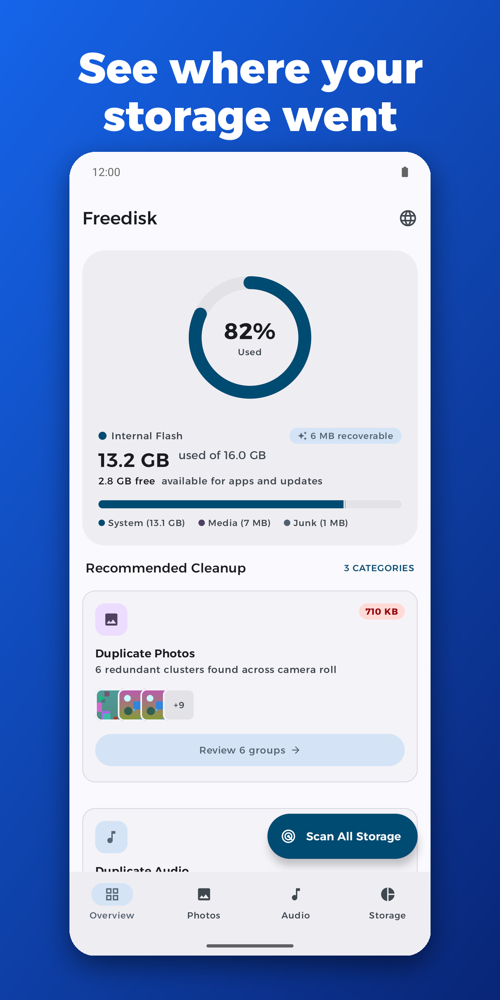
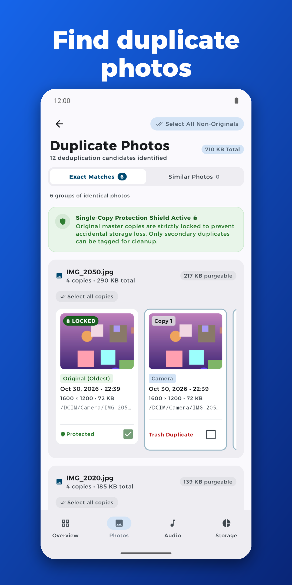
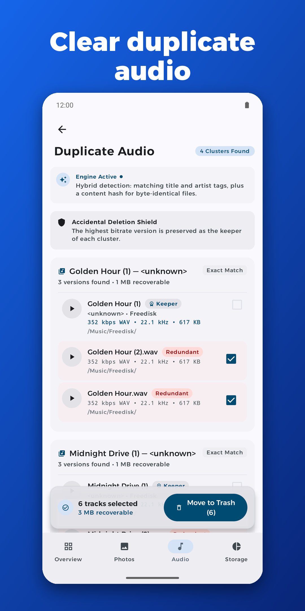
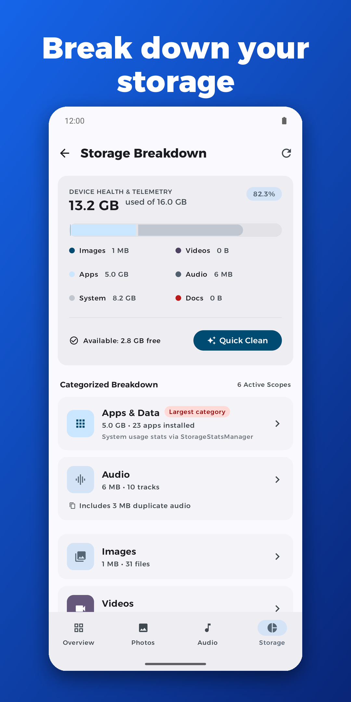

# Freedisk

Freedisk is an Android storage-cleaning app. It helps people get their phone storage back by finding duplicate photos, duplicate audio, junk files and large files, and by showing where their space is going. It was designed from a Figma file, built from scratch and published on Google Play.

**[Get Freedisk on Google Play](https://play.google.com/store/apps/details?id=com.omega.freedisk)**

> The source code is not published in this repository. This page describes what the project does and how it was built.

## Screenshots

  
  
  
  

## What the app does

- **Overview.** A single screen showing how full the device storage is, how much space can be recovered, and a one-tap cleanup for junk and app cache.
- **Duplicate photos.** Finds photos that are exactly the same and photos that are visually similar, groups them, and lets the user choose which copies to remove.
- **Duplicate audio.** Finds repeated audio files so they can be cleared in one go.
- **Storage breakdown.** Splits storage by category and by app, and lists large files such as big videos, so the user can see what is taking space.
- **Privacy first.** Everything is analysed on the device. Nothing is uploaded, and files are deleted only after the user reviews and confirms.

## Languages and accessibility

- Full English and Arabic support, including right-to-left layouts.
- An in-app language switcher in addition to following the phone's language.
- Arabic-Indic digits when the app is in Arabic.
- Layouts adapted for small phones, with the same design scaling up to larger screens.

## How it is built

- **Language and UI:** Kotlin and Jetpack Compose with Material 3, following the Figma design closely.
- **Architecture:** each feature is split into three layers. The data layer reads from the Android storage APIs, the domain layer holds the entities and the repository contract, and the presentation layer holds the screens and view models. Each view model exposes a single screen state and a separate stream for one-off events.
- **Dependency injection:** Hilt.
- **Async work:** Kotlin coroutines and Flow, with WorkManager for background tasks.
- **Storage access:** Android's media and storage-statistics APIs, with the minimum permissions needed and a clear explanation of each one.
- **Charts:** a charting library for the storage breakdown.
- **Splash and icon:** a custom launcher icon and splash screen.

## Ads and consent

The app is free and supported by Google AdMob, with an adaptive banner and native ads placed between list items. Ads are only requested after Google's consent flow (User Messaging Platform) allows it, and users in regions that require it can reopen their privacy choices from inside the app.

## Release engineering

Publishing to Google Play included:

- Creating a signing key and building a signed Android App Bundle
- Shrinking and obfuscating the release build with R8, and keeping the mapping file to read crash reports
- Preparing the store listing: description, icon, feature graphic and phone and tablet screenshots
- Completing Play's declarations: data safety, privacy policy, content rating and permission justifications
- Testing the release build and rolling it out

## A lesson from the first release

The first public build crashed on launch, before the splash screen could appear. Debug builds worked, so it only showed up after publishing. Reproducing the release build on an emulator and reading the crash log showed that the code optimizer had renamed parts of Kotlin's own standard library inconsistently. Narrowing what the optimizer was allowed to touch fixed it, and the fix shipped as version 2. The main takeaway: always test the exact release build, not just the debug build, before publishing.

## Tech summary

Kotlin, Jetpack Compose, Material 3, Hilt, Coroutines and Flow, DataStore, WorkManager, AdMob, Google User Messaging Platform, R8, Google Play Console.

## Author

Built by Kareem Nehad.
